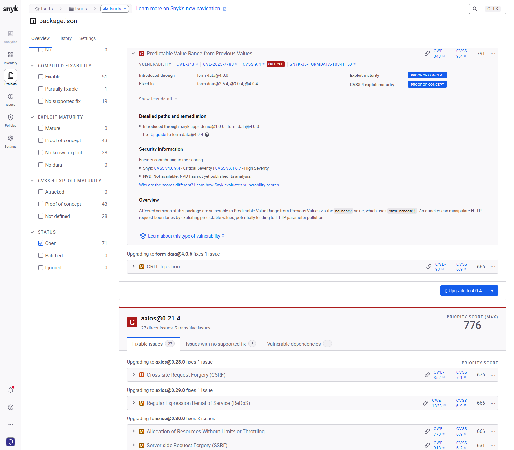

# DevSecOps დავალება

ამ დავალებისთვის [Snyk-ის დემო პროექტის](https://github.com/snyk/snyk-apps-demo) fork გავაკეთე და კომპიუტერშიც გადმოვწერე.
შესამოწმებლად გამოვიყენე Snyk და Trivy.

პროექტის ახლანდელ ვერსიაში Trivy-მ Critical პრობლემა ვერ იპოვა, ამიტომ სასწავლოდ
ძველი კომიტი `273f07a` ავიღე. ის ცალკე `training-baseline` ბრენჩზეა,
ხოლო `main`-ზე ახლანდელი ვერსია დარჩა.

## 1. სკანირების შედეგი

Snyk-ის ონლაინ სკანერში **4 Critical პრობლემა** გამოჩნდა. ერთ-ერთი იყო:

- **პაკეტი:** `form-data@4.0.0`
- **პრობლემა:** CVE-2025-7783
- **შეფასება:** Critical, CVSS 4.0 — **9.4**
- **სად ჩანს:** `package.json` და `package-lock.json`

ამ ვერსიაში multipart მოთხოვნის ნაწილების გამყოფი მნიშვნელობის წინასწარ გამოცნობაა შესაძლებელი.
გარკვეულ პირობებში ამის გამოყენებით თავდამსხმელს მოთხოვნაში დამატებითი პარამეტრების ჩასმა შეუძლია.

**როგორ გასწორდება:** ამ პრობლემას `form-data@4.0.4` ასწორებს.
სკანერმა სხვა პრობლემისთვის 4.0.6-იც შემოგვთავაზა, ამიტომ განახლებისთვის
**4.0.6 ან უფრო ახალ თავსებად ვერსიას** ავირჩევდი. შემდეგ საჭიროა lockfile-ის განახლება,
ტესტების გაშვება და ხელახალი სკანირება.
[პრობლემის აღწერა Snyk-ზე](https://security.snyk.io/vuln/SNYK-JS-FORMDATA-10841150).

Trivy-ითაც შევამოწმე პროექტი, development დამოკიდებულებების ჩათვლით.
ძველ ვერსიაში მან **6 Critical აღმოჩენა** აჩვენა, ახლანდელში კი — **0**.
სკანერები ერთნაირად არ აფასებენ და ერთნაირი მოცვით არ ამოწმებენ ყველაფერს, ამიტომ შედეგებიც განსხვავდება.
[ძველი ვერსიის ანგარიში](docs/devsecops-assignment/evidence/trivy-baseline.txt) /
[ახლანდელი ვერსიის ანგარიში](docs/devsecops-assignment/evidence/trivy-current.txt).

Snyk-ის დამოკიდებულებების სკანირება შესრულდა, თუმცა `tsconfig.json`-ის ცალკე იმპორტისას JSON-ის შეცდომა გამოჩნდა.

## 2. საიდუმლო მონაცემები

Git-ის ისტორიაში ძველ `.env.local` ფაილებში ვიპოვე `CLIENT_SECRET` და `ENCRYPTION_SECRET`.
ისინი `14a8456` და `875a53f` კომიტებში, მე-3 და მე-6 ხაზებზე იყო ჩაწერილი.
პროექტის ავტორის ჩანაწერით, ეს მნიშვნელობები უკვე ვადაგასულია. მათი მოქმედება არ შემიმოწმებია
და თვითონ მნიშვნელობები ანგარიშში არ ჩამიწერია.
[დაფარული მონაცემებით შენახული ჩანაწერი](docs/devsecops-assignment/evidence/secrets-redacted.json).

ამის თავიდან ასაცილებლად საიდუმლო მონაცემები გარემოს ცვლადებში ან CI-ის secrets-ში უნდა შევინახოთ.
საიდუმლოებით შევსებული `.env` ფაილი Git-ში არ უნდა მოხვდეს, ამიტომ ის `.gitignore`-ში უნდა დაემატოს.
თუ მოქმედი გასაღები უკვე აიტვირთა, ის უნდა გაუქმდეს და შეიცვალოს.
მხოლოდ ფაილის წაშლა საკმარისი არ არის — ძველ კომიტებში ის მაინც რჩება.

Trivy-მ შემოწმებულ ფაილებში secrets ვერ იპოვა. ეს მაგალითი Git-ის ისტორიის ცალკე გადახედვით გამოჩნდა.

## 3. CIS Docker-ის წესი

ავირჩიე წესი, რომლის მიხედვითაც აპლიკაცია კონტეინერში root-ით არ უნდა გაეშვას. 
ამისთვის Dockerfile-ში ცალკე მომხმარებელი უნდა შევქმნათ და `USER`-ით ავირჩიოთ. 
მას მხოლოდ აპლიკაციისთვის საჭირო უფლებები უნდა ჰქონდეს. 
ასე, აპლიკაციის გატეხვის შემთხვევაში, თავდამსხმელს ნაკლები შესაძლებლობა ექნება.

პაიპლაინში Trivy-ის კონფიგურაციის სკანირება შეიძლება დაემატოს:
თუ [root-ით გაშვების შემოწმება](https://avd.aquasec.com/misconfig/dockerfile/general/avd-ds-0002/) ვერ გაივლის,
build უნდა გაჩერდეს. ეს მხოლოდ შემოთავაზებაა; ამ პროექტზე კონტეინერის შემოწმება არ გამიშვია.
[წყარო: CIS Docker](https://www.cisecurity.org/benchmark/docker).

## 4. რა ვისწავლე

ყველაზე მეტად ის დამამახსოვრდა, რომ ფაილის წაშლა საიდუმლო მონაცემების სრულად წაშლას არ ნიშნავს,
რადგან ისინი Git-ის ისტორიაში რჩება. ასევე საინტერესო იყო Snyk-ისა და Trivy-ის განსხვავებული შედეგების ნახვა.
ამან დამანახა, რომ მხოლოდ სკანერის გაშვება არ არის საკმარისი — უნდა გავიგოთ, რას ამოწმებს ის
და როგორ შეიძლება ნაპოვნი პრობლემის გამოსწორება.
